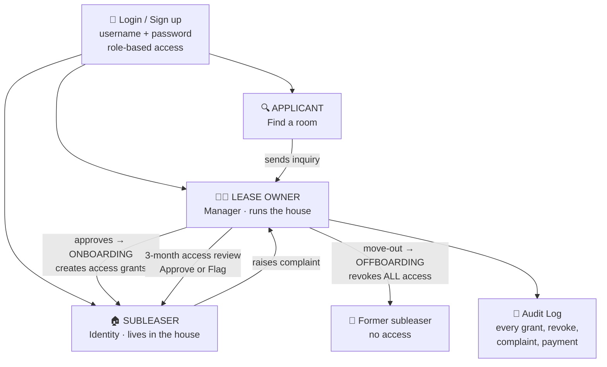
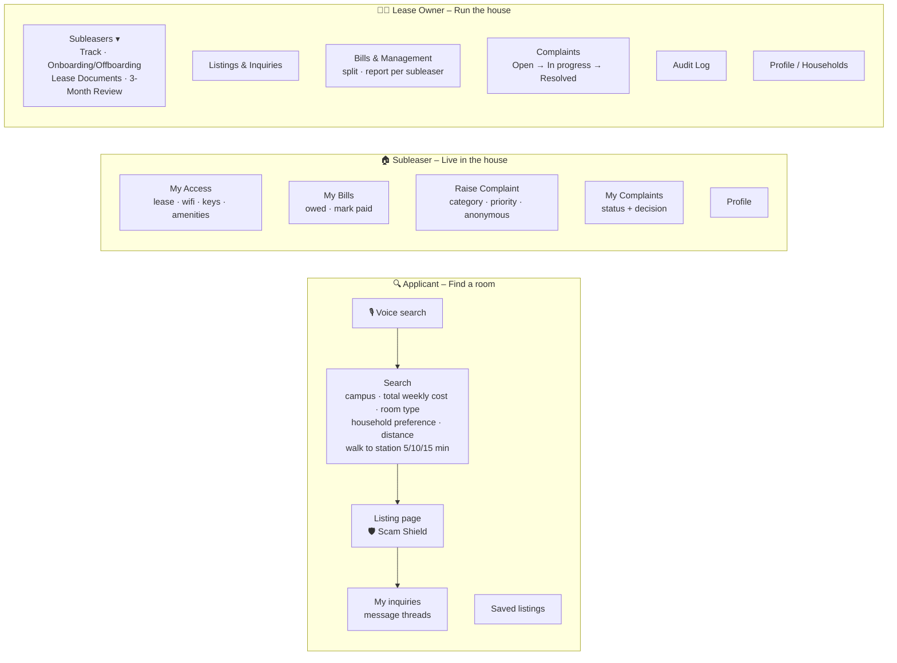

# CampusNest – App Structure

How CampusNest is organised: three roles, one login, and an IAM lifecycle that connects them.

> **Story:** Applicant → *onboarding (joiner)* → Subleaser → *offboarding (leaver)* → all access revoked.

---

## 1. Role flow (IAM lifecycle)



---

## 2. Screens by role



---

## 3. Full structure (text version)

```
                        ┌──────────────────────┐
                        │  LOGIN / SIGN UP     │
                        │  username, password  │
                        │  choose role         │
                        └─────────┬────────────┘
          ┌───────────────────────┼────────────────────────┐
          ▼                       ▼                        ▼
 ┌─────────────────┐   ┌────────────────────┐   ┌─────────────────────────┐
 │  APPLICANT      │   │  SUBLEASER         │   │  LEASE OWNER (manager)  │
 └─────────────────┘   └────────────────────┘   └─────────────────────────┘

APPLICANT – Find a room
 ├─ Search
 │   ├─ Choose campus (MQ, USYD, UNSW, UTS, WSU)
 │   ├─ Filters: total weekly cost, room type,
 │   │   household (female-only / female preferred / male preferred / any),
 │   │   distance from campus, walk to station (5/10/15 min)
 │   ├─ Voice search
 │   └─ Listing card: true cost, km, station walk time, badges
 ├─ Listing page → Scam Shield warnings → Send inquiry
 ├─ My inquiries (message threads)
 └─ Saved listings
          │  approved by lease owner (ONBOARDING)
          ▼
SUBLEASER – Live in the house
 ├─ My Access: lease document, wifi, keys, amenities (only while Active)
 ├─ My Bills: what I owe, mark paid
 ├─ Raise Complaint: category, priority, optional anonymous
 ├─ My Complaints: status + owner's decision
 └─ Profile

LEASE OWNER – Run the house
 ├─ Subleasers ▾
 │   ├─ Track: members, review due, open complaints, outstanding bills
 │   ├─ Onboarding / Offboarding: approve applicant → grant access;
 │   │                            move-out → revoke ALL access
 │   ├─ Lease Documents
 │   └─ 3-Month Access Review: Approve (renew) or Flag
 ├─ Listings & Inquiries: post rooms, reply to applicants
 ├─ Bills & Management: add bill → auto split → report per subleaser
 ├─ Complaints: Open → In progress → Resolved + decision note
 ├─ Audit Log: every grant, revoke, complaint, payment
 └─ Profile / Households
```

---

## 4. IAM mapping

| IAM concept | In CampusNest |
|---|---|
| Identity | Subleaser account |
| Manager | Lease owner |
| Roles (RBAC) | Applicant, Subleaser, Lease Owner |
| Joiner | Onboarding: approved applicant receives access grants |
| Access grants | Lease agreement, wifi, bill share, keys, amenities |
| Access review | 3-month check: Approve or Flag |
| Leaver | Offboarding: move-out revokes all grants |
| Audit | Append-only log of every access and household action |

---

_Design: Vedant (lease owner dashboard) · Concept and prompts: Sadhvika · Built with Sym AI for Sym AI Open 2026._
